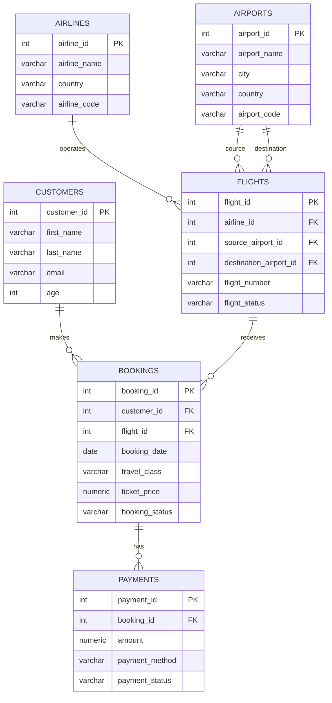
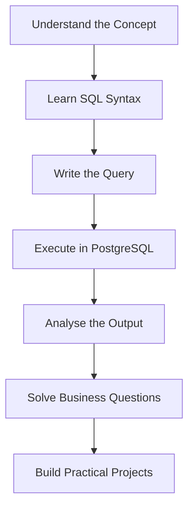

<div align="center">

# ✈️ AIRLINE & TRAVEL ANALYTICS
### SQL Learning Journey | PostgreSQL


<br>


**A hands-on SQL learning repository based on real-world airline and travel business scenarios.**

</div>

---

# 👋 Welcome to My SQL Learning Journey!

Hello! I'm Kirti.

This repository documents my journey of learning **SQL and PostgreSQL from fundamentals to advanced data analysis**.

Instead of learning SQL only through theoretical examples, I am working with a practical Airline & Travel Management Database.

The database represents business scenarios involving:

- ✈️ Airlines and airport operations
- 🎫 Flight schedules and bookings
- 👥 Customer management
- 💳 Payment transactions
- 📊 Booking and revenue analysis
- 🌍 Travel operations and business reporting

My goal is to understand how SQL is used in real companies to retrieve, filter, analyse and interpret business data.

---

# 🎯 What Am I Learning?

<div align="center">

| SQL Fundamentals | Data Analysis | Advanced SQL |
|:---:|:---:|:---:|
| SELECT | COUNT() | Subqueries |
| WHERE | SUM() | CTEs |
| DISTINCT | AVG() | Window Functions |
| ORDER BY | GROUP BY | RANK() |
| LIMIT | HAVING | CASE WHEN |
| AND / OR | JOINS | PARTITION BY |
| IN / BETWEEN | Data Analysis | Advanced Reporting |

</div>

---

# 🗺️ My SQL Learning Roadmap

Follow the roadmap step by step.

## 🟢 LEVEL 1 – SQL FUNDAMENTALS

- [ ] Introduction to Databases
- [ ] Understanding Tables, Rows and Columns
- [ ] Introduction to PostgreSQL
- [ ] Understanding Primary Keys and Foreign Keys
- [ ] SELECT Statement
- [ ] SELECT *
- [ ] Selecting Specific Columns
- [ ] Column Aliases using AS
- [ ] DISTINCT

## 🟡 LEVEL 2 – FILTERING DATA

- [ ] WHERE Clause
- [ ] Comparison Operators (=, <>, >, <, >=, <=)
- [ ] AND Operator
- [ ] OR Operator
- [ ] NOT Operator
- [ ] IN and NOT IN
- [ ] BETWEEN
- [ ] LIKE and ILIKE
- [ ] IS NULL and IS NOT NULL
- [ ] Combining Multiple Conditions

## 🟠 LEVEL 3 – SORTING AND LIMITING

- [ ] ORDER BY
- [ ] ASC – Ascending Order
- [ ] DESC – Descending Order
- [ ] LIMIT
- [ ] Sorting Using Multiple Columns

## 🔵 LEVEL 4 – AGGREGATE FUNCTIONS

- [ ] COUNT()
- [ ] SUM()
- [ ] AVG()
- [ ] MIN()
- [ ] MAX()

## 🟣 LEVEL 5 – DATA GROUPING

- [ ] GROUP BY
- [ ] HAVING
- [ ] Airline-wise Analysis
- [ ] Booking-wise Analysis
- [ ] Travel Class Analysis
- [ ] Payment Analysis

## 🔴 LEVEL 6 – SQL JOINS

- [ ] INNER JOIN
- [ ] LEFT JOIN
- [ ] RIGHT JOIN
- [ ] FULL OUTER JOIN
- [ ] Joining Multiple Tables
- [ ] Understanding Table Relationships

## 🟤 LEVEL 7 – ADVANCED SQL

- [ ] CASE WHEN
- [ ] Subqueries
- [ ] Common Table Expressions (CTEs)
- [ ] UNION and UNION ALL
- [ ] Window Functions
- [ ] ROW_NUMBER()
- [ ] RANK()
- [ ] DENSE_RANK()
- [ ] PARTITION BY
- [ ] Running Totals

---

# 🗄️ Our Airline & Travel Database

We are working with six relational database tables.

| Table Name | Description |
|:---|:---|
| airlines | Stores airline company information |
| airports | Stores airport details |
| customers | Stores customer information |
| flights | Stores flight schedules and status |
| bookings | Stores customer flight bookings |
| payments | Stores payment transactions |

## 📊 Database Structure



### 🔗 Understanding Relationships

- Airlines connect to Flights using `airline_id`.
- Airports connect to Flights using `source_airport_id` and `destination_airport_id`.
- Customers connect to Bookings using `customer_id`.
- Flights connect to Bookings using `flight_id`.
- Bookings connect to Payments using `booking_id`.

---

# 💻 CURRENT LEARNING MODULE

<div align="center">

## WHERE CLAUSE – DATA FILTERING


**Learn how to retrieve only the records that match specific business conditions.**

</div>

### 1. SELECT – Retrieve All Records

```sql
SELECT *
FROM airlines;
```

### 2. WHERE – Filter Customers

```sql
SELECT *
FROM customers
WHERE country = 'India';
```

### 3. AND – Apply Multiple Conditions

```sql
SELECT *
FROM customers
WHERE country = 'India'
AND age > 30;
```

### 4. OR – Match Either Condition

```sql
SELECT *
FROM customers
WHERE country = 'India'
OR country = 'UK';
```

### 5. IN – Match Multiple Values

```sql
SELECT *
FROM bookings
WHERE travel_class IN ('Business', 'First Class');
```

### 6. NOT IN – Exclude Multiple Values

```sql
SELECT *
FROM bookings
WHERE travel_class NOT IN ('Business', 'First Class');
```

### 7. BETWEEN – Filter a Range

```sql
SELECT *
FROM bookings
WHERE ticket_price BETWEEN 30000 AND 80000;
```

### 8. LIKE – Search by Pattern

```sql
SELECT *
FROM customers
WHERE first_name LIKE 'A%';
```

### 9. ILIKE – Case-Insensitive Search

```sql
SELECT *
FROM customers
WHERE country ILIKE 'india';
```

### 10. IS NULL – Find Missing Values

```sql
SELECT *
FROM customers
WHERE gender IS NULL;
```

---

# 🧠 PRACTICE CHALLENGES

Try solving these business questions independently.

| No. | Business Question | SQL Concept |
|---:|---|---|
| 01 | Find customers from the USA. | WHERE |
| 02 | Find customers older than 35. | Comparison Operators |
| 03 | Find all pending or cancelled bookings. | IN |
| 04 | Find payments made using UPI. | WHERE |
| 05 | Find bookings priced between ₹40,000 and ₹1,00,000. | BETWEEN |
| 06 | Find customers whose first name starts with S. | LIKE |
| 07 | Find flights that are not completed. | NOT |
| 08 | Find customers from India who are younger than 30. | AND |
| 09 | Find bookings that are not Economy class. | NOT IN |
| 10 | Find customers from the UK or USA who are older than 30. | AND / OR |

---

# 💼 REAL-WORLD BUSINESS ANALYSIS

As I progress, I will use SQL to answer practical business questions.

✈️ Which airlines operate the flights in our database?

🎫 How many bookings are confirmed, cancelled or pending?

💰 What is the total booking value?

🌍 Which countries do our customers belong to?

💳 Which payment methods are most frequently used?

📊 Which travel class has the highest booking value?

⏰ How many flights are delayed or cancelled?

📈 What is the airline-wise booking performance?

**Future project extension:** We will add group booking, passenger volume, seat capacity and airline allocation data to analyse group travel operations more deeply.

---

# ⚙️ TOOLS & TECHNOLOGIES

<div align="center">


</div>

- PostgreSQL – Database management
- pgAdmin – SQL query execution and database management
- Git – Version control
- GitHub – Project documentation and portfolio

---

# 📁 REPOSITORY STRUCTURE

```text
airline-travel-sql-learning/
│
├── README.md
│
├── 00-database-setup/
│   └── airline_database_setup.sql
│
├── 01-select/
│   └── select_practice.sql
│
├── 02-where/
│   └── where_practice.sql
│
├── 03-order-by-limit/
│   └── sorting_and_limit.sql
│
├── 04-aggregate-functions/
│   └── aggregate_practice.sql
│
├── 05-group-by-having/
│   └── grouping_practice.sql
│
├── 06-joins/
│   └── joins_practice.sql
│
├── 07-case-when/
│   └── conditional_logic.sql
│
├── 08-subqueries-ctes/
│   └── subqueries_ctes.sql
│
├── 09-window-functions/
│   └── window_functions.sql
│
└── 10-business-case-studies/
    └── airline_analysis.sql
```

---

# 🚀 MY LEARNING APPROACH



### My Learning Principles

- Understand concepts instead of memorising syntax.
- Practise every query independently.
- Use real-world business scenarios.
- Debug errors and understand why they occur.
- Maintain organised SQL scripts.
- Build practical analytical projects.

---

<div align="center">

# 🌟 EVERY QUERY TAKES ME ONE STEP FORWARD!


### ✈️ From Airline Operations to Data Analytics

**My journey from SQL fundamentals to business intelligence starts here.**


</div>


